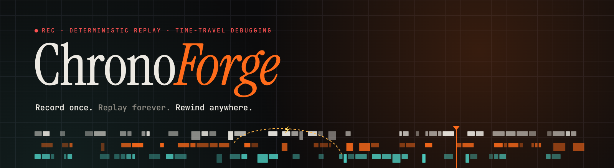
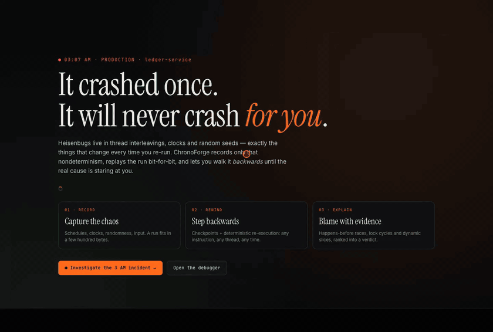
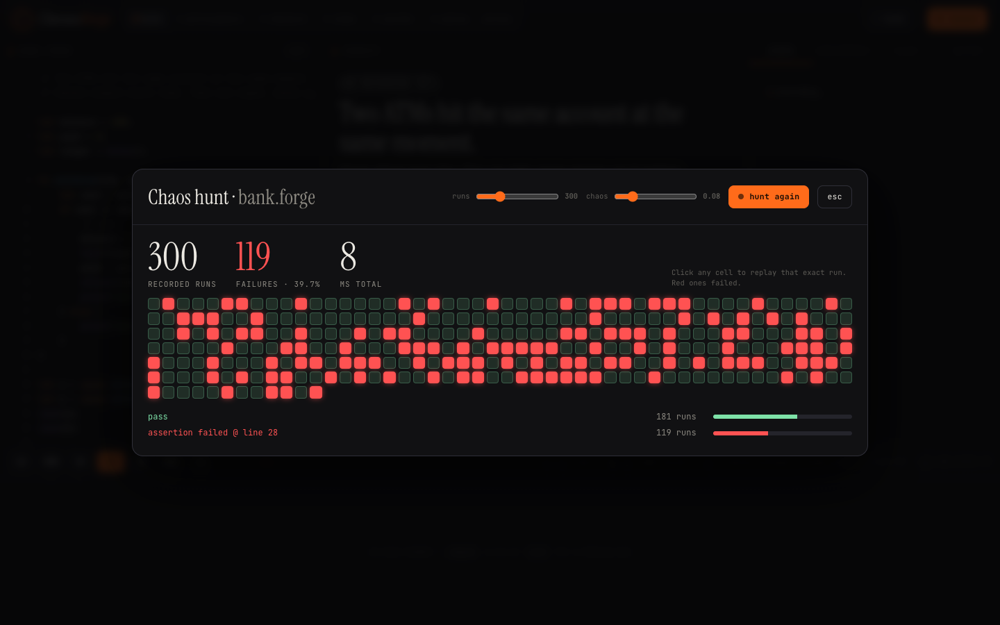
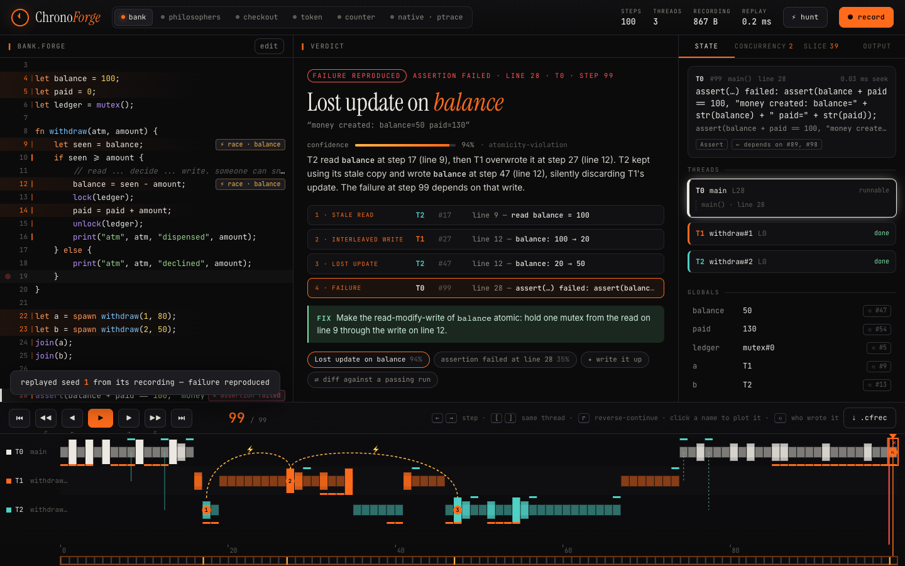
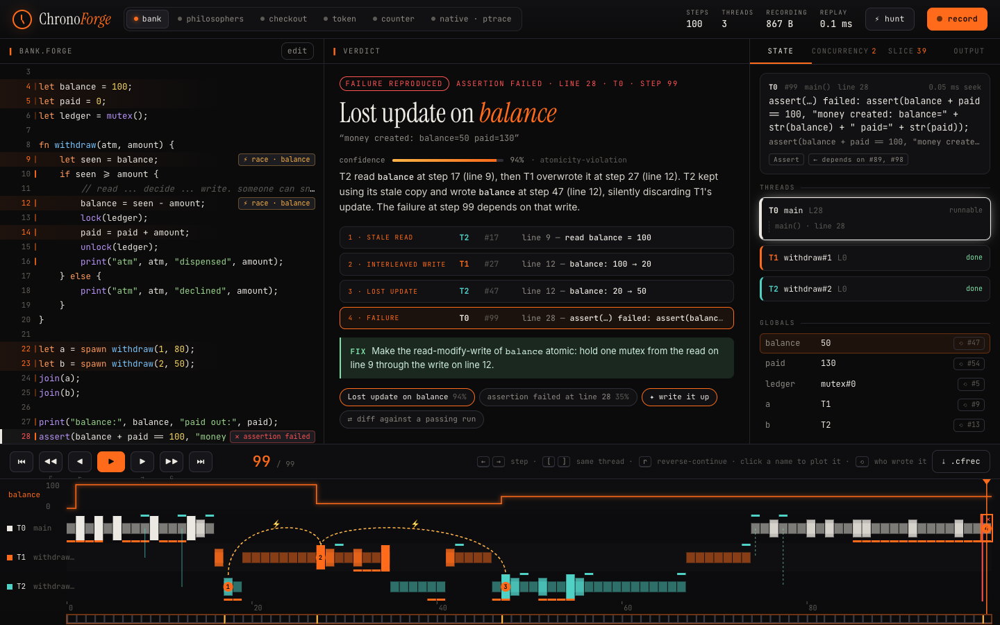
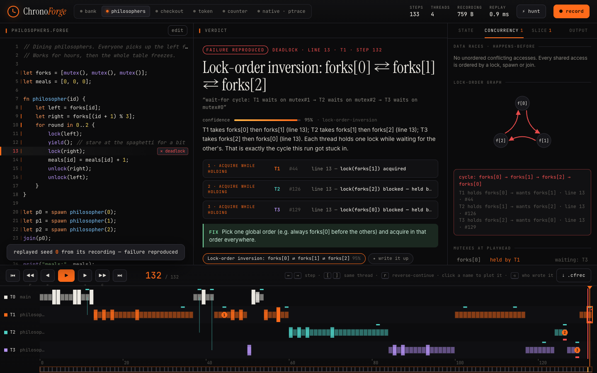
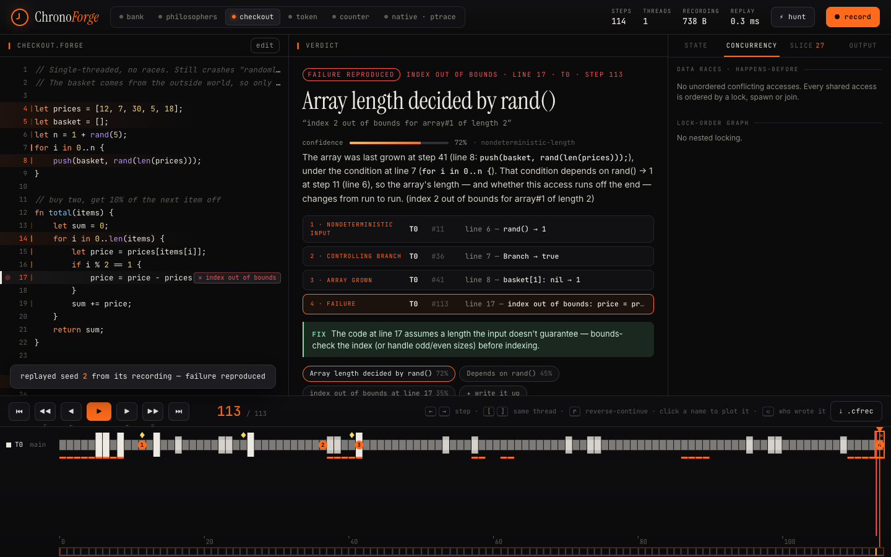
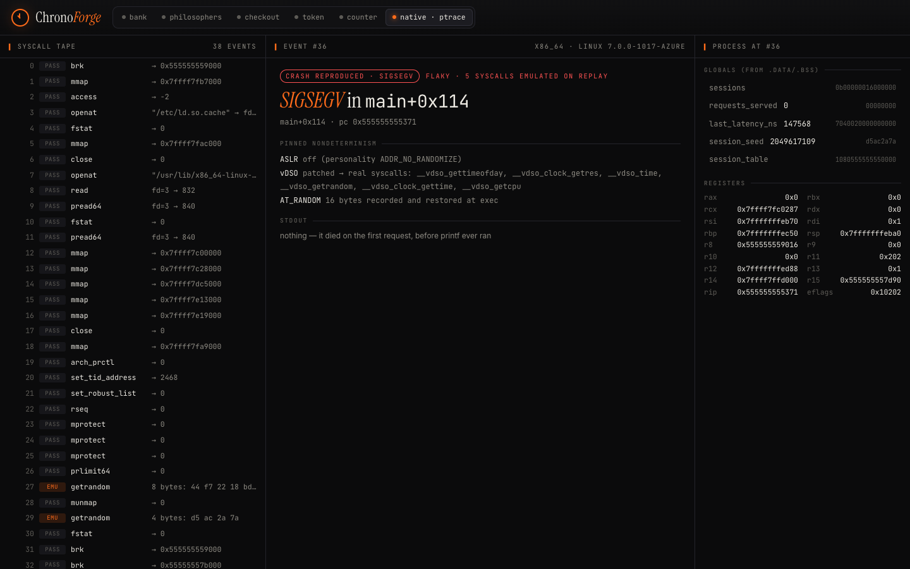

<p align="center">
  
</p>

<p align="center">
  <a href="https://github.com/coolstack-coder/ChronoForge/actions/workflows/ci.yml"></a>
  
  
  
  
  
</p>

<h3 align="center">A deterministic record/replay engine and time-travel debugger.<br>It catches the bug that only happens at 3 AM, then lets you walk backwards to its cause.</h3>

<br>

<p align="center">
  <a href="docs/media/chronoforge-demo.mp4"></a>
  <br>
  <sub>▶ <a href="docs/media/chronoforge-demo.mp4"><b>Full 1:44 demo with subtitles (MP4)</b></a> · captions: <a href="docs/media/chronoforge-demo.srt">.srt</a> / <a href="docs/media/chronoforge-demo.vtt">.vtt</a> · the GIF plays at 2.4×</sub>
</p>

---

## ⏱ 03:07 AM

```
03:07:12.481 [ledger-svc] ERROR invariant violated: money created: balance=50 paid=130
03:07:12.482 [pager]      WARN  SEV-2 opened, on-call paged
03:41:09.003 [you]        INFO  re-ran it 40 times locally. passes every time.
04:15:55.310 [you]        INFO  added logging. now it never fails. great.
```

Some bugs only happen when threads interleave a particular way, when the clock lands on a bad millisecond, or when a random seed comes out unlucky. Re-running the program changes all of those, so the bug disappears. Logs tell you *that* it happened, not *why*. A debugger only sees the run in front of you, and that run is fine.

**ChronoForge records the nondeterminism instead of the execution.** Every scheduling decision, every clock read, every random number and every input goes into a log a few hundred bytes long. Replaying that log reproduces the run bit-for-bit, as many times as you like. On top of the replay you get:

| | |
|---|---|
| ⏪ **Reverse debugging** | Step backwards, reverse-continue to a breakpoint, and ask "who wrote this value?" to jump straight to the writer. |
| 🎲 **Chaos hunting** | Record hundreds of runs under a preempting scheduler (like rr's chaos mode). Every failure you find is already a replayable recording. |
| ⚡ **Concurrency analysis** | Happens-before race detection with vector clocks, lock-order (Goodlock) cycles, and wait-for deadlock cycles. |
| 🧭 **Root cause with evidence** | Backward dynamic slicing over a recorded data-flow graph, lost-update detection and control-dependence tracking, ranked into a verdict that cites exact steps. |
| ⇄ **Run diffing** | First schedule divergence and first *data* divergence between a passing and a failing run. |
| 🐧 **Native Linux binaries** | A `ptrace` recorder/replayer for real ELF programs. It patches the vDSO, turns ASLR off, pins `AT_RANDOM`, emulates syscalls on replay, and seeks to the faulting instruction. |
| ✦ **LLM write-ups, grounded** | An optional Claude narrator turns the evidence into an incident note. Any narrative that cites a step the engine never produced is rejected. |

---

## 🔍 What you're looking at

<table>
<tr>
<td width="50%"><br><b>Hunt.</b> 300 recorded schedules of <code>bank.forge</code> in well under a second. About 40% of them lose money. Click a red cell and that exact run is replayed from its recording, not re-run.</td>
<td width="50%"><br><b>Verdict.</b> <i>Lost update on <code>balance</code></i>, 94% confidence. T2 read 100, T1 wrote 20 in between, and T2 wrote its stale 50 over it. Each evidence row jumps the timeline to that step.</td>
</tr>
<tr>
<td><br><b>Value history.</b> Click any variable to plot it over time above the thread lanes (100 → 20 → 50). <code>⟲ #47</code> is a reverse watchpoint: it takes you to the step that wrote the value.</td>
<td><br><b>Deadlock.</b> Dining philosophers freeze. The lock-order graph shows the <code>forks[0] → forks[1] → forks[2] → forks[0]</code> cycle and the three acquisitions that closed it.</td>
</tr>
<tr>
<td><br><b>No threads, still flaky.</b> An out-of-bounds read that only happens for some baskets. The slice follows the array's length back through the loop that grew it, to <code>rand()</code> on line 6.</td>
<td><br><b>Native.</b> A real C program recorded under <code>ptrace</code> on a GitHub Actions kernel. You can see which syscalls get emulated on replay (<code>getrandom</code>, the clock, stdin) and the <code>SIGSEGV</code> at <code>main+0x114</code>, with registers and globals at that moment.</td>
</tr>
</table>

---

## 🧠 How it works

```mermaid
flowchart LR
    subgraph REC["① record — cheap"]
        P[Forge program] --> C[compiler +<br/>instrumentation pass]
        C --> VM[deterministic VM]
        O1((chaos scheduler<br/>clock · rand · input)) -- every decision --> VM
        VM --> LOG[(nondeterminism log<br/>~800 bytes)]
    end
    subgraph REPLAY["② replay — exact"]
        LOG --> RO((replay oracle)) --> VM2[same VM, probes on]
        VM2 --> TRACE[(instrumented trace<br/>reads · writes · deps · sync)]
        VM2 --> CK[(checkpoints<br/>every 512 steps)]
    end
    subgraph ASK["③ ask questions"]
        CK --> SEEK[seek&#40;n&#41;: restore nearest checkpoint,<br/>re-execute forward] --> UI
        TRACE --> HB[vector clocks → races]
        TRACE --> LG[lock-order graph → cycles]
        TRACE --> SL[dynamic slice → root cause]
        HB & LG & SL --> V[ranked verdict + evidence] --> UI[timeline UI / CLI / gRPC]
    end
```



### 1 · Deterministic record & replay
The VM (`cf-vm`) never touches the outside world directly. Everything nondeterministic goes through one trait, `Oracle`:

```rust
pub trait Oracle {
    fn schedule(&mut self, m: &Machine, runnable: &[Tid]) -> Result<Tid, VmError>;
    fn rand(&mut self, step: Step, bound: i64) -> Result<i64, VmError>;
    fn clock(&mut self, step: Step) -> Result<i64, VmError>;
    fn input(&mut self, step: Step) -> Result<String, VmError>;
}
```

`RecordOracle` makes the decisions (a seeded chaos scheduler, the real wall clock) and logs each one. `ReplayOracle` feeds them back and refuses to improvise: if the program asks for `now()` where the log has a context switch, that's a **divergence error**, not a silent wrong answer. Thread switches are logged only when they happen, so a 100-step run with 3 threads records about 10 events. The tests check that replaying 60 different chaos seeds reproduces the *instrumented trace* byte for byte, and that tampered logs are caught.

### 2 · Reverse execution
You can't run a CPU backwards. rr and WinDbg TTD don't either. During replay ChronoForge drops a full machine checkpoint every 512 steps. `seek(n)` clones the nearest checkpoint at or before `n` and re-executes forward. Because replay is deterministic, that's indistinguishable from going back in time, and it costs at most 511 steps. Every value also carries **shadow provenance**: the step that produced each operand, and the step that last wrote each local, global and heap cell. That's why the UI can answer *"who wrote this?"* instantly.

### 3 · Compile-time instrumentation
`cf-lang` compiles Forge to bytecode, then runs an instrumentation pass that tags each instruction with probes. It works like a sanitizer pass in LLVM: `ACCESS` for the trace, `SHARED` for memory another thread could see (globals, heap), `SYNC` for happens-before edges, and `NONDET` for inputs that must go into the recording. Locals never get race checks because they can't escape a frame. `chronoforge disasm` shows the plan:

```
fn#0 withdraw (params=2, locals=3)
     0  L9    shared LoadGlobal(0)
     1  L9    access StoreLocal(2)
    ...
    12  L13   sync   Builtin { b: Lock, argc: 1 }
```

### 4 · Finding the cause
* **Races:** FastTrack-style vector clocks over spawn, join and lock edges. Two conflicting accesses with no happens-before order are a race, *even if this run didn't fail*. The test suite proves both directions: `bank.forge` is flagged in passing runs too, and the correctly locked `counter.forge` produces zero reports across 20 schedules.
* **Deadlocks:** the VM detects "nothing runnable, something blocked" and reports the wait-for cycle. Separately, a Goodlock lock-order graph finds inversions that *could* deadlock.
* **Slicing:** from the failing instruction, walk the recorded data dependencies backwards. That's exact, because the VM recorded which step produced each operand. Each step also records its **dynamic control dependence** (the branch that caused it to run). That catches bugs data-flow alone misses, like an array whose *length* came from `rand()` through a loop bound.
* **Ranking:** hypotheses such as *atomicity violation* (a read, an interleaved write, then a stale write), *data race on the slice*, *nondeterministic length*, *lock-order inversion* and *value origin* each get a confidence score and a list of evidence steps. Nothing is asserted without a step number behind it.

### 5 · Native programs (`cf-ptrace`)
A separate, rr-style backend for **single-threaded Linux ELF binaries** on x86_64 and aarch64:

| nondeterminism | how it's pinned |
|---|---|
| `clock_gettime`, `gettimeofday`, `time`, `getcpu` via the **vDSO** (no syscall, so invisible to ptrace) | at exec, the vDSO's ELF symbols are parsed and each function is overwritten with a 3-instruction stub that makes a real `syscall` (`mov eax,nr; syscall; ret` / `mov x8,#nr; svc #0; ret`) |
| ASLR | `personality(ADDR_NO_RANDOMIZE)` before `execve` |
| `AT_RANDOM` (stack canary, pointer guard) | 16 bytes read from `/proc/pid/auxv`, written back at exec on replay |
| environment / stack layout | a fixed `envp` in both runs |
| `getrandom`, clocks, pids, sleeps, reads from pipes/ttys/sockets | **emulated** on replay: the syscall is cancelled (`orig_rax = -1` / `NT_ARM_SYSTEM_CALL`) and the recorded return value and out-buffers are injected |
| `mmap`, `brk`, file reads, writes… | run for real, and the syscall sequence is checked for divergence |

`chronoforge native replay run.json --at N` re-executes to event N (or to the faulting instruction) and dumps registers, the stack and every `.data`/`.bss` global by name. Replay catches surprisingly small differences. An early version gave the replayed process `/dev/null` as stdin, and glibc probes a character device with one extra `isatty` ioctl that it never sends for a pipe. ChronoForge flagged it as a divergence at event 27.

---

## 🚀 Quickstart

```bash
git clone https://github.com/coolstack-coder/ChronoForge && cd ChronoForge
(cd ui && npm ci && npm run build)            # the web UI
cargo run --release -- serve                  # http://127.0.0.1:7420 (gRPC on :7421)
```

Or stay in the terminal:

```console
$ chronoforge hunt examples/forge/bank.forge --runs 200
▁█▁▁▁██▁▁▁█▁▁▁▁▁▁█▁█▁▁▁█▁▁▁▁█▁███▁███▁▁▁▁█▁▁▁▁█▁▁▁███▁▁█▁▁▁▁▁▁▁▁▁▁█▁▁▁▁▁▁▁▁▁▁▁█…
hunted 200 runs in 23.3ms
  assertion failed @ line 28            70 runs ( 35.0%)  first: seed 1
  pass                                 130 runs ( 65.0%)  first: seed 0
  saved fail → recordings/bank-fail-seed1.cfrec

$ chronoforge analyze recordings/bank-fail-seed1.cfrec
outcome assertion failed at line 28 (T0, step 99): money created: balance=50 paid=130

data races
  ⚡ balance      T2 line 9 (Read) ⟷ T1 line 12 (Write)
  ⚡ balance      T1 line 12 (Write) ⟷ T2 line 12 (Write)

hypotheses
  1. Lost update on `balance` 94%
     T2 read `balance` at step 17 (line 9), then T1 overwrote it at step 27 (line 12).
     T2 kept using its stale copy and wrote `balance` at step 47 (line 12) …
     · step 17     T2 line 9   stale read — read balance = 100
     · step 27     T1 line 12  interleaved write — balance: 100 → 20
     · step 47     T2 line 12  lost update — balance: 20 → 50
     fix: Make the read-modify-write of `balance` atomic: hold one mutex from the read on line 9 through the write on line 12.

$ chronoforge replay recordings/bank-fail-seed1.cfrec --at 27     # state right after step 27
$ chronoforge diff recordings/bank-pass-seed0.cfrec recordings/bank-fail-seed1.cfrec
```

Native, on Linux:

```bash
cc -O0 -g -o flaky examples/native/flaky.c
chronoforge native record -o run.json --stdin-text 'GET /\nGET /health\n' -- ./flaky
chronoforge native replay run.json            # same output, same crash, every time
chronoforge native replay run.json --at 36    # stop at the SIGSEGV and dump the process
```

<details>
<summary><b>All commands</b></summary>

| command | what it does |
|---|---|
| `record <file.forge> [--seed N] [--chaos P] [--input S]… [--full]` | run once, write a `.cfrec` |
| `replay <rec.cfrec> [--at STEP]` | verify the replay, print state after `STEP` |
| `hunt <file.forge> [--runs N] [--chaos P]` | chaos-schedule N recordings, save the first fail and pass |
| `analyze <rec.cfrec>` | races, lock cycles, slice, ranked hypotheses |
| `diff <a.cfrec> <b.cfrec>` | first schedule/data divergence |
| `disasm <file.forge>` | bytecode with instrumentation probes |
| `bench <files…>` | record/replay/seek throughput and recording size |
| `serve [--store memory\|file\|rocksdb]` | HTTP API + UI and the gRPC service |
| `native record\|replay\|show` | ptrace backend (Linux) |

</details>

---

## 📏 Numbers

`chronoforge bench examples/forge/*.forge` on an M-series laptop, release build:

| program | steps | record | instrumented replay | seek (avg) | recording | full trace |
|---|---:|---:|---:|---:|---:|---:|
| `bank.forge` | 91 | 0.3 M steps/s | 3.1 M steps/s | 8 µs | 0.8 KB | 4 KB |
| `checkout.forge` | 204 | 5.7 M steps/s | 2.9 M steps/s | 15 µs | 0.7 KB | 7 KB |
| `counter.forge` | 1235 | 4.8 M steps/s | 6.6 M steps/s | 24 µs | 1.4 KB | 28 KB |
| `philosophers.forge` | 161 | 5.5 M steps/s | 4.7 M steps/s | 10 µs | 0.8 KB | 6 KB |
| `token.forge` | 51040 | 7.5 M steps/s | 4.3 M steps/s | 29 µs | 0.6 KB | 1009 KB |

`token.forge` runs 51k instructions and records them in **well under 1 KB**. Replaying them with every read, write and dependency instrumented produces a megabyte of trace, which is ~1,700× more than you had to store. A seek anywhere in the run takes tens of microseconds.

*Recording* is the whole `.cfrec` file, including the program's source. *Full trace* is the same file with every instrumented step event stored. That gap is the whole idea: you ship the small one and rebuild the big one by replay.

---

## 🧪 Forge, the language

A deliberately small language (functions, globals, arrays, `spawn`/`join`, `mutex`/`lock`/`unlock`, `yield`, and the nondeterministic `rand`/`now`/`input`). Small enough to instrument every instruction, big enough to write real race conditions in. Five annotated programs live in [`examples/forge`](examples/forge):

| program | the bug | what ChronoForge says |
|---|---|---|
| `bank.forge` | unsynchronised read-modify-write | lost update, data race, schedule diff |
| `philosophers.forge` | everyone grabs left fork first | wait-for cycle + lock-order inversion |
| `checkout.forge` | off-by-one only for even-sized random baskets | slice → control dependence → `rand()` |
| `token.forge` | 2 ms TTL vs. real wall-clock time | the `now()` values are in the recording |
| `counter.forge` | none (correctly locked) | no races, no cycles: no false positives |

---

## 🏗 Architecture

```
crates/
  cf-trace      event model · .cfrec segmented format (LZ4 + CRC32 frames, footer index) · file / RocksDB / memory stores
  cf-lang       Forge lexer, parser, compiler, instrumentation pass
  cf-vm         deterministic interpreter, green threads, record/replay oracles, checkpointed Timeline, snapshots
  cf-analysis   vector-clock races · lock-order graph · dynamic slicing · root-cause ranking · run diff
  cf-ptrace     Linux native recorder/replayer (x86_64 + aarch64)
  cf-server     axum JSON API for the UI + tonic gRPC service (proto/chronoforge.proto)
  chronoforge   the CLI
ui/             React + TypeScript (Vite), canvas timeline, no UI framework
analysis/       optional Python + Claude narrator with step-citation grounding
demo/           Playwright scripts that record the README video, screenshots and banner
```

| layer | stack |
|---|---|
| core engine | Rust 2021, zero `unsafe` outside `cf-ptrace` |
| program tracing | Linux `ptrace` (`PTRACE_GET_SYSCALL_INFO`, `GETREGSET`), `/proc/pid/mem`, vDSO patching |
| compiler instrumentation | probe-planning pass in `cf-lang` |
| execution storage | `.cfrec` files by default; **RocksDB** backend behind `--features rocksdb` (big-endian step keys → range scans) |
| backend | Rust, **axum** (REST) + **tonic** (gRPC; `protox` compiles the proto, no `protoc` needed) |
| visualization | React 18 + TypeScript, `<canvas>` timeline |
| AI analysis | Python, Anthropic SDK (`claude-opus-5-5`, structured output, grounding check) |

**gRPC**: `Record`, `Hunt` (server-streaming), `Seek`, `StreamSteps` (server-streaming) and `Analyze`. See [`proto/chronoforge.proto`](proto/chronoforge.proto). A test spins up the server and drives every RPC through the generated client.

**REST** (what the UI uses): `POST /api/sessions`, `POST /api/hunt`, `POST /api/hunt/{id}/open/{seed}`, `GET /api/sessions/{id}/{timeline,state?step=,analysis,history?loc=,export}`, `GET /api/sessions/{a}/diff/{b}`, `POST /api/sessions/{id}/explain`, `GET /api/native/{id}`.

### Optional: LLM incident notes
```bash
pip install -e analysis && export ANTHROPIC_API_KEY=…
chronoforge serve     # "✦ write it up" in the verdict panel now asks Claude
```
The model gets the program, the failure, the hypotheses, races and slice. It must cite step numbers, and `chronoforge_ai` checks every cited step (in the list *and* in the prose) against the evidence. Without a key you get the same write-up generated deterministically.

---

## ✅ Tested, honestly

CI runs on **ubuntu x86_64, ubuntu arm64 and macOS**: `fmt`, `clippy -D warnings`, and 35 Rust tests (30 everywhere, plus the Linux-only ptrace and RocksDB ones) and the Python suite. These include byte-identical replay across 60 chaos seeds, backward seeks checked against fresh replays, race detection with no false positives, analysis on every example, the HTTP and gRPC APIs end to end, and the RocksDB store. The **ptrace tests run on real kernels on both architectures**: record, replay with identical stdout, seek to the `SIGSEGV`, and globals that match the recording. The [native trace in the repo](examples/native/recordings/flaky.json) was captured by CI itself.

**Limits, stated plainly:**
- Arbitrary *native* multithreaded programs aren't supported (the ptrace backend is single-threaded, as rr was at first). Multithreaded record/replay, race and deadlock detection run on the instrumented VM.
- Natively, async signals, `rdtsc` and shared memory with other processes aren't recorded yet. All three are on the roadmap (`PR_SET_TSC` trapping is the obvious next step).
- Instrumentation is a bytecode pass, not an LLVM pass. Porting the probe plan to an LLVM `FunctionPass` for C/C++ is the natural next milestone.

---

<p align="center"><sub>Built by <b>Anmol Advani</b> · MIT licensed · inspired by <a href="https://rr-project.org">Mozilla rr</a> and Microsoft Time Travel Debugging</sub></p>
